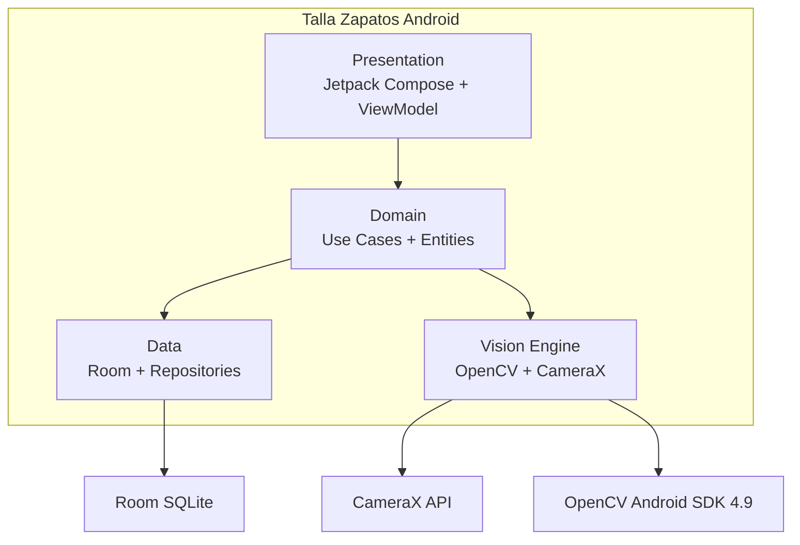
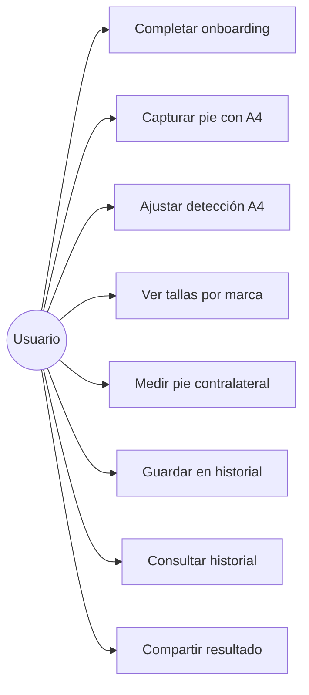
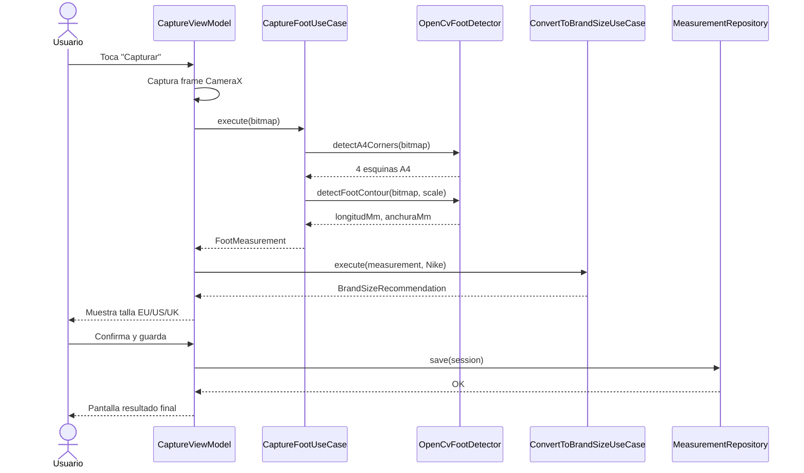
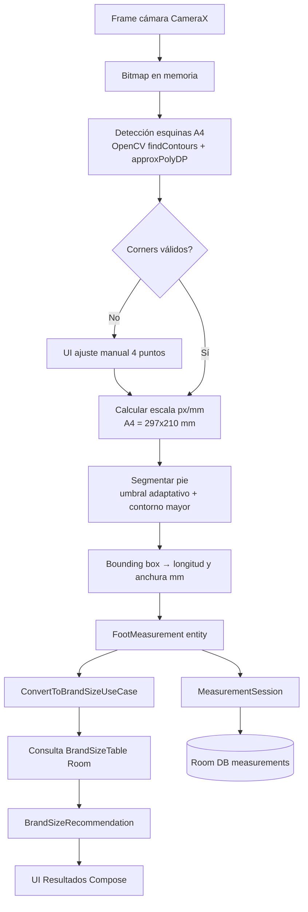
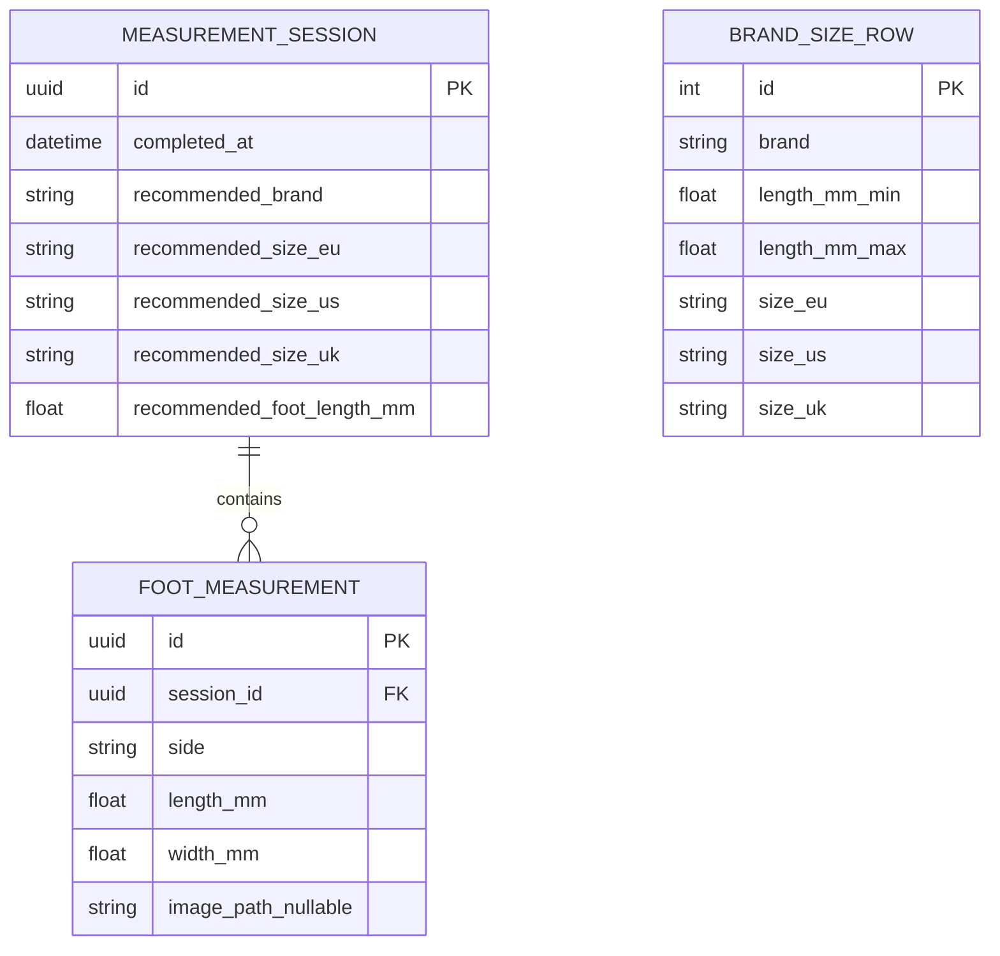

# Diseño y Arquitectura — Talla Zapatos Android

## 1. Resumen Ejecutivo

**Talla Zapatos Android** es una aplicación móvil nativa que permite a cualquier usuario medir la longitud y anchura de sus pies usando la cámara del teléfono y una hoja A4 como referencia de escala. El sistema convierte las medidas físicas (milímetros) a tallas de calzado según tablas de equivalencia de marcas populares (Nike, Adidas, Puma, Converse, New Balance).

**Objetivo de negocio:** Reducir devoluciones por talla incorrecta en compras online de calzado, ofreciendo una medición casera gratuita sin hardware adicional.

**Alcance MVP (Release 1):** Flujo completo punta a punta: onboarding → captura guiada con A4 → procesamiento on-device → resultado con talla EU/US/UK por marca → guardar historial local. Sin cuenta de usuario ni backend en MVP.

## 2. Requisitos Funcionales (RF)

| ID | Requisito | Prioridad | Módulo |
|---|---|---|---|
| RF-001 | El usuario puede completar un onboarding que explica cómo colocar el pie sobre una hoja A4 y conceder permiso de cámara | Must | Onboarding |
| RF-002 | La app solicita y gestiona el permiso `CAMERA` en tiempo de ejecución según Android 13+ | Must | Permisos |
| RF-003 | El usuario puede capturar una foto del pie sobre A4 con guía visual de encuadre (overlay) | Must | Captura |
| RF-004 | El sistema detecta automáticamente los bordes del A4 en la imagen para calcular escala (px/mm) | Must | Visión |
| RF-005 | El sistema detecta el contorno del pie y calcula longitud y anchura en milímetros | Must | Visión |
| RF-006 | El usuario puede ajustar manualmente los 4 puntos del rectángulo del A4 si la detección automática falla | Must | Captura |
| RF-007 | El sistema convierte medidas mm a talla EU, US y UK usando tablas de equivalencia internas | Must | Conversión |
| RF-008 | El usuario puede seleccionar una marca (Nike, Adidas, Puma, Converse, New Balance) y ver la talla recomendada para esa marca | Must | Marcas |
| RF-009 | El usuario puede medir ambos pies (izquierdo y derecho) en una misma sesión | Must | Sesión |
| RF-010 | El sistema muestra recomendación final indicando el pie más largo y la talla sugerida | Must | Resultados |
| RF-011 | El usuario puede guardar el resultado en historial local con fecha, medidas y tallas por marca | Must | Historial |
| RF-012 | El usuario puede consultar mediciones anteriores desde una pantalla de historial | Should | Historial |
| RF-013 | El usuario puede compartir el resultado como imagen o texto vía intent de Android | Could | Compartir |
| RF-014 | La app funciona sin conexión a internet después de la instalación | Must | Offline |
| RF-015 | El usuario puede recalibrar/repetir la captura si el resultado parece incorrecto | Must | Captura |

## 3. Requisitos No Funcionales (RNF)

| ID | Requisito | Métrica medible |
|---|---|---|
| RNF-001 | Rendimiento de procesamiento de imagen | Detección A4 + contorno de pie en < 3 s en dispositivo gama media (Snapdragon 695, 4 GB RAM) |
| RNF-002 | Precisión de medición | Error ≤ ±3 mm vs. regla física en 90% de capturas con buena iluminación |
| RNF-003 | Tamaño de APK | APK release ≤ 45 MB (OpenCV empaquetado por ABI) |
| RNF-004 | Compatibilidad | minSdk 26, targetSdk 34, soporte arm64-v8a y armeabi-v7a |
| RNF-005 | Privacidad | Imágenes procesadas solo en memoria; no se suben a servidores; historial almacenado localmente |
| RNF-006 | Usabilidad | Usuario nuevo completa primera medición en < 3 minutos sin leer documentación externa |
| RNF-007 | Accesibilidad | Contraste mínimo 4.5:1 en textos; soporte TalkBack en botones principales |
| RNF-008 | Mantenibilidad | Cobertura de tests unitarios en módulo `domain` ≥ 80% |
| RNF-009 | Disponibilidad offline | 100% de funcionalidades MVP operativas sin red |
| RNF-010 | Seguridad local | Base de datos Room sin datos sensibles de identidad; solo medidas y tallas |

## 4. Arquitectura del Sistema

**Estilo:** Monolito modular Android con Clean Architecture (capas `presentation` → `domain` → `data`) y procesamiento de visión 100% on-device.

**Justificación:** No se requiere backend en MVP; el procesamiento de imagen es intensivo pero breve y debe ejecutarse localmente por privacidad y offline-first. Clean Architecture separa la lógica de conversión de tallas (domain) del SDK de OpenCV (data), facilitando tests y sustitución futura del motor de visión.

## 5. Diagramas Técnicos

### 5.1 Diagrama de Casos de Uso

### 5.2 Diagrama de Clases (UML)

```mermaid
classDiagram
    class FootMeasurement {
        +UUID id
        +Float lengthMm
        +Float widthMm
        +FootSide side
        +Instant capturedAt
    }

    class BrandSizeRecommendation {
        +Brand brand
        +String sizeEU
        +String sizeUS
        +String sizeUK
        +Float confidence
    }

    class MeasurementSession {
        +UUID id
        +FootMeasurement leftFoot
        +FootMeasurement rightFoot
        +BrandSizeRecommendation finalRecommendation
        +Instant completedAt
    }

    class BrandSizeTable {
        +Brand brand
        +Float lengthMmMin
        +Float lengthMmMax
        +String sizeEU
        +String sizeUS
        +String sizeUK
    }

    class CaptureFootUseCase {
        +execute(image: Bitmap) Result~FootMeasurement~
    }

    class ConvertToBrandSizeUseCase {
        +execute(measurement: FootMeasurement, brand: Brand) BrandSizeRecommendation
    }

    class FootMeasurementRepository {
        <<interface>>
        +save(session: MeasurementSession)
        +getAll() List~MeasurementSession~
    }

    class OpenCvFootDetector {
        +detectA4Corners(bitmap) List~Point~
        +detectFootContour(bitmap, scale) ContourResult
    }

    CaptureFootUseCase --> OpenCvFootDetector
    CaptureFootUseCase --> FootMeasurement
    ConvertToBrandSizeUseCase --> BrandSizeTable
    ConvertToBrandSizeUseCase --> BrandSizeRecommendation
    FootMeasurementRepository --> MeasurementSession
    MeasurementSession --> FootMeasurement
    MeasurementSession --> BrandSizeRecommendation
```

### 5.3 Diagrama(s) de Secuencia

**Flujo crítico: Captura y cálculo de talla**

## 6. Flujo de Datos

## 7. Modelo de Datos

**Tablas Room:**

| Tabla | PK | Índices | Descripción |
|---|---|---|---|
| `measurement_sessions` | `id` (UUID) | `completed_at DESC` | Sesión con recomendación final |
| `foot_measurements` | `id` (UUID) | `session_id` | Medición por pie (LEFT/RIGHT) |
| `brand_size_rows` | `id` (INTEGER AUTO) | `(brand, length_mm_min)` UNIQUE | Tabla precargada desde assets JSON en primer arranque |

**Seed de datos:** Archivo `assets/brand_sizes.json` con ~120 filas (5 marcas × ~24 tallas EU).

## 8. Historias de Usuario (nivel épica)

1. Como **usuario nuevo**, quiero entender cómo posicionar mi pie y el A4, para obtener una medición precisa en el primer intento.
2. Como **usuario**, quiero capturar mi pie con la cámara y ver la talla al instante, para comprar zapatos online con confianza.
3. Como **usuario**, quiero elegir la marca que voy a comprar, para ver la equivalencia de talla específica de esa marca.
4. Como **usuario**, quiero medir ambos pies en una sesión, para que la app recomiende la talla del pie más largo.
5. Como **usuario**, quiero guardar y revisar mis mediciones anteriores, para comparar evolución o reutilizar sin repetir el proceso.
6. Como **usuario**, quiero repetir la captura si algo salió mal, para corregir errores de encuadre sin reiniciar la app.

## 9. Stack Tecnológico

| Capa | Tecnología | Justificación |
|---|---|---|
| Lenguaje | Kotlin 1.9.24 | Estándar Android moderno, corrutinas nativas |
| UI | Jetpack Compose 1.6 + Material 3 | Desarrollo declarativo rápido para MVP con 1-2 devs |
| Arquitectura | MVVM + Clean Architecture | Separación testeable; ViewModels sobreviven rotaciones |
| Cámara | CameraX 1.3.4 | Abstrae fragmentación de APIs de cámara |
| Visión | OpenCV Android 4.9.0 | Detección de contornos A4 y pie probada y offline |
| Persistencia | Room 2.6.1 + SQLite | Historial local tipado con migraciones |
| Inyección DI | Hilt 2.51 | Integración oficial con Android, scope por módulo |
| Navegación | Navigation Compose 2.7 | Grafo tipado entre pantallas del flujo |
| Tests unitarios | JUnit 5 + MockK | Estándar en proyectos Kotlin |
| Tests UI | Compose UI Test + Espresso | Validación de flujos críticos |
| CI | GitHub Actions | Build + lint + tests en cada PR |
| Build | Gradle 8.7 + AGP 8.5 | Compilación actual con desugaring |

## 10. Decisiones de Arquitectura (ADR resumido)

| # | Decisión | Alternativa descartada | Motivo |
|---|---|---|---|
| ADR-01 | Referencia A4 para escala | ARCore depth / objeto de referencia impreso | A4 universal, sin dependencia ARCore ni hardware LiDAR |
| ADR-02 | OpenCV on-device | ML Kit Pose / modelo TFLite custom | Contorno de pie sobre fondo blanco no requiere entrenar modelo; OpenCV es determinista y debuggable |
| ADR-03 | Sin backend en MVP | API cloud para tablas de tallas | Offline-first, cero costo infra, privacidad de imagen del pie |
| ADR-04 | Room con seed JSON | Firebase Remote Config | Datos de tallas estáticos; actualización en Release 2 vía assets o Play Asset Delivery |
| ADR-05 | Monolito modular single-module → multi-module en Sprint 2 | Microservicios | App móvil no justifica distribución de servicios |
| ADR-06 | minSdk 26 | minSdk 21 | CameraX y rendimiento OpenCV degradan en API < 26 |
